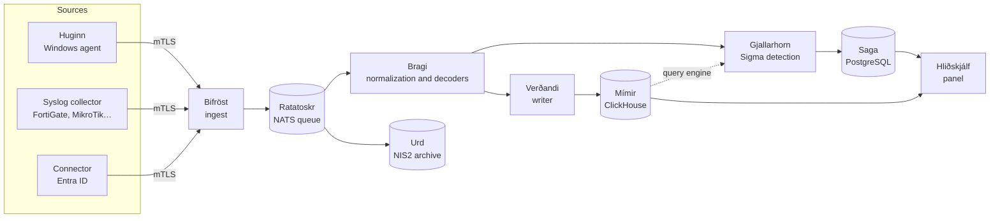

<div align="center">

# Vardr

**An open-source SIEM for small and mid-sized organisations – log collection, threat detection, incidents and an archive built for NIS2.**

[](LICENSE)
[](go.mod)
[](docs/en/rules.md)
[](CHANGELOG.md)

[Features](#what-it-does) · [Architecture](#how-it-works) · [Installation](#quick-start) · [Documentation](#documentation) · [License](#license)

<p>🇬🇧 <b>English</b> · 🇵🇱 <a href="README.pl.md">Polski</a></p>

</div>

**Vardr** – in Norse mythology a guardian spirit that keeps constant watch and warns – is a complete SIEM that runs on a single server and installs with a single command. It collects events from Windows computers, network devices and the Microsoft cloud, detects attacks with Sigma rules, takes the analyst from an alert to a closed incident and keeps the original logs in an archive that cannot be silently altered – as required by the NIS2 directive.

It is built for organisations for which a commercial SIEM is too expensive and assembling one from open-source parts too much work: companies, local governments, schools and hospitals that must detect incidents and report them on time, but have no team to run Elasticsearch.

The panel, notifications and the user documentation are available in English and Polish – every account picks its own panel language, and the administrator picks the language of notifications (*Notifications → System language*).

## What it does

**📥 Event collection**
- **Windows agent (Huginn)** – Security, System, PowerShell, Sysmon, Microsoft Defender logs and more; profiles for workstations, servers and domain controllers; MSI installer and deployment via GPO.
- An agent that is hard to switch off: protected service, disk buffer for connection outages, guaranteed delivery (batch deduplication), CPU, memory and bandwidth limits.
- **Syslog collector** with device decoders (FortiGate, MikroTik and your own – described in YAML, tested on samples in the panel).
- **Entra ID connector** – sign-ins and directory changes from Microsoft Graph.
- Agent enrollment with a one-time token, mTLS certificates issued automatically, revocation from the panel.

**🔎 Detection**
- Rules in the open **[Sigma](https://sigmahq.io)** format, in two engines: **streaming** (an alert within seconds) and **query** on the event database (catches up after outages and late events).
- Thresholds, grouping, **correlations** across rules and sources (e.g. password spraying across several systems, an account created and immediately added to the administrators group).
- Mapping to **MITRE ATT&CK**, person identities linked across accounts and sources.
- **Trial mode** – a rule counts hits without alerting before you enable it; bulk changes with a reason recorded in the audit log.
- Import of the open **SigmaHQ** library with one command (about 1,500 rules for the collected sources, disabled by default).

**🚨 Alerts and incidents**
- Alerts with event context, triage, notifications (Discord, webhook) with protection against alert storms.
- **Incidents** grouping alerts, findings, IoCs and a timeline; a status workflow with a final closure.
- **NIS2 deadlines** – early warning (24 h), notification (72 h) and final report with reminders and drafts of reports to the CSIRT.

**🗄️ NIS2 archive (Urd)**
- Original event batches in segments with a **SHA-256 hash chain** and a daily anchor sent outside the system – every change to the archive is detectable.
- Regular integrity verification, retention with a policy that a compromised panel cannot shorten.
- **Auditor export** with an independent reader and **replay** of events from the archive for analysis.

**🖥️ Panel (Hliðskjálf)**
- Event search with its own query language, agent and pipeline status, management of rules, decoders and backups.
- Sign-in with **Active Directory** accounts (LDAPS) with group mapping, **second factor (TOTP)**, permission profiles module by module, a complete audit log.

**⚙️ Operations**
- **Installer** – one script sets up the whole stack on Docker: secrets, certificates, systemd services, the first account; the same script upgrades.
- Encrypted **backups** scheduled from the panel (local, SFTP, SMB, S3) and restore from the panel.
- Pipeline monitoring in Grafana, failure alerts, queues that delay data under overload instead of losing it – the pipeline was tested at **7,000 events/s for 8 hours**.

## How it works



An event goes from the agent to the queue and is acknowledged only after it is written – a failure of any service ends in a delay, not in data loss. Stateless services (ingest, normalization, writing) scale by adding replicas. Components are named after Norse mythology (descriptive names in the code); more: [architecture](docs/en/architecture.md).

## Quick start

Requirements: Linux x86_64 with systemd (Debian 12/13, Ubuntu 24.04+), Docker Engine with the compose plugin, 8 GB RAM, 60 GB of disk.

Download `vardr-<version>-linux-amd64.tar.gz` and `SHA256SUMS` from the [latest release](https://github.com/Azujo/Vardr/releases/latest), then:

```bash
sha256sum -c --ignore-missing SHA256SUMS
tar xzf vardr-<version>-linux-amd64.tar.gz
cd vardr-<version>-linux-amd64
sudo ./install.sh
```

The installer asks for the server address, prepares everything and finally shows the panel address (`https://<server>:8444`), the administrator's initial password and the backup password. Then in the panel: *Agents* → an installation package or an enrollment token for Windows computers.

Releases are built by GitHub Actions from a version tag ([development](docs/en/development.md#releases)); a bundle can also be built locally with `deploy/vardr/build-bundle.sh`. Details, upgrades and removal: [docs/en/installation.md](docs/en/installation.md).

## Documentation

| | |
|---|---|
| [Installation](docs/en/installation.md) | server from the bundle, upgrade, syslog collector and Entra ID connector |
| [Windows agent](docs/en/agent.md) | installation (MSI, GPO), protection, buffer, limits, audit policy |
| [Panel](docs/en/panel.md) | modules, permissions, search, working with alerts and incidents, NIS2, languages |
| [Detection rules](docs/en/rules.md) | writing and testing Sigma rules, correlations, trial mode, translations, SigmaHQ import |
| [Decoders](docs/en/decoders.md) | a new syslog device or API source step by step |
| [Architecture](docs/en/architecture.md) | components, event flow, databases, security |
| [Operations](docs/en/operations.md) | backups, retention, migrations, diagnostics |
| [Programs](docs/en/programs.md) | the services and command-line tools and their settings |
| [Development](docs/en/development.md) | building, tests, conventions, translations |

Full index: [docs/en/](docs/en/README.md). Changes between versions: [CHANGELOG](CHANGELOG.md). The roadmap, project history and lab notes are in Polish: [ROADMAP](docs/ROADMAP.md), [PODSUMOWANIE](docs/PODSUMOWANIE.md), [laboratorium](docs/laboratorium.md).

## Project status

Vardr has completed its MVP stage (October 2026): all the features described work in a test environment with an Active Directory domain, network devices and an Entra ID simulator, and the pipeline has passed load tests. It is developed by one person – bug reports and ideas are very welcome ([CONTRIBUTING](CONTRIBUTING.md)).

## License

Copyright © 2026 Marcin Krzemianowski "Azujo" and Vardr contributors.

Vardr is free software under the [GNU Affero General Public License 3.0 or later](LICENSE) (`AGPL-3.0-or-later`): you may use it (also commercially), modify and distribute it. Anyone who makes a modified version available – also as a network service (e.g. a SIEM for customers) – must make its source code available to its users under the same license. The panel shows a link to the source code (menu footer); a modified version should point to its own repository.

The license does not cover the SigmaHQ rules (a separate DRL 1.1 license, see below) or the third-party programs run in the stack (NATS, ClickHouse, PostgreSQL, Grafana, Prometheus – each under its own license). How to contribute changes: [CONTRIBUTING.md](CONTRIBUTING.md).

## Acknowledgements

Vardr's detection is based on the [Sigma](https://sigmahq.io) format, and the panel can import the open [SigmaHQ](https://github.com/SigmaHQ/sigma) rule library – several thousand rules written and maintained by the community of security analysts. Thank you to the authors and maintainers for great work. SigmaHQ rules are licensed under the [Detection Rule License (DRL) 1.1](https://github.com/SigmaHQ/Detection-Rule-License); Vardr does not bundle them – the administrator imports them (`sigmahq-import.sh` or the instructions in the panel), and the panel shows the author, source and license with every rule and alert.

Vardr also uses excellent open-source projects: [NATS](https://nats.io), [ClickHouse](https://clickhouse.com), [PostgreSQL](https://www.postgresql.org), [Grafana](https://grafana.com), [Prometheus](https://prometheus.io), [Mantine](https://mantine.dev) and [React](https://react.dev).
