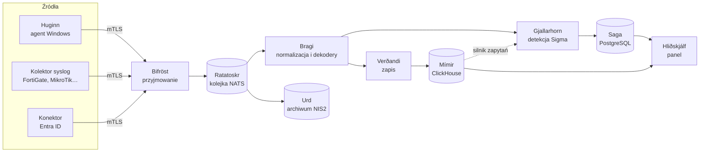

<div align="center">

# Vardr

**Otwarty SIEM dla małych i średnich organizacji – zbieranie logów, detekcja zagrożeń, incydenty i archiwum pod NIS2.**

[](LICENSE)
[](go.mod)
[](docs/reguly.md)
[](docs/PODSUMOWANIE.md)

[Funkcje](#co-potrafi) · [Architektura](#jak-to-działa) · [Instalacja](#szybki-start) · [Dokumentacja](#dokumentacja) · [Licencja](#licencja)

</div>

<p align="center">🇬🇧 <a href="README.md">English</a> · 🇵🇱 <b>Polski</b></p>

> Panel, powiadomienia i dokumentacja są dostępne po polsku i po angielsku – język wybiera każde konto w panelu, a język wiadomości – administrator (*Powiadomienia → Język systemu*).

**Vardr** – w mitologii nordyckiej duch-strażnik, który stale czuwa i ostrzega – to kompletny system SIEM, który da się postawić na jednym serwerze jednym poleceniem. Zbiera zdarzenia z komputerów Windows, urządzeń sieciowych i chmury Microsoft, wykrywa ataki regułami Sigma, prowadzi analityka od alertu do zamkniętego incydentu i przechowuje oryginalne logi w archiwum, którego nie da się po cichu zmienić – tak, jak wymaga tego dyrektywa NIS2 i ustawa o krajowym systemie cyberbezpieczeństwa.

Powstał z myślą o organizacjach, dla których komercyjny SIEM jest za drogi, a złożenie go z klocków open source za pracochłonne: firmach, samorządach, szkołach i szpitalach, które muszą wykrywać incydenty i zgłaszać je w terminie, a nie mają zespołu do utrzymania Elasticsearcha.

## Co potrafi

**📥 Zbieranie zdarzeń**
- **Agent Windows (Huginn)** – dzienniki Security, System, PowerShell, Sysmon, Microsoft Defender i inne; profile dla stacji, serwerów i kontrolerów domeny; instalator MSI i wdrożenie przez GPO.
- Agent odporny na wyłączenie: chroniona usługa, bufor dyskowy na czas przerwy w łączności, gwarancja dostarczenia (deduplikacja paczek), limity CPU, pamięci i pasma.
- **Kolektor syslog** z dekoderami urządzeń (FortiGate, MikroTik i własne – opisywane w YAML, testowane na próbkach w panelu).
- **Konektor Entra ID** – logowania i zmiany w katalogu z Microsoft Graph.
- Rejestracja agentów jednorazowym tokenem, certyfikaty mTLS wystawiane automatycznie, unieważnianie z panelu.

**🔎 Detekcja**
- Reguły w otwartym formacie **[Sigma](https://sigmahq.io)**, w dwóch silnikach: **w locie** (alert w sekundy) i **zapytań** na bazie zdarzeń (nadrabia przerwy i spóźnione zdarzenia).
- Progi, grupowanie, **korelacje** między regułami i źródłami (np. password spraying z wielu systemów, konto utworzone i od razu dodane do grupy administratorów).
- Mapowanie na **MITRE ATT&CK**, tożsamości osób łączone między kontami i źródłami.
- **Tryb próbny** – reguła liczy trafienia bez alarmowania, zanim ją włączysz; zmiany zbiorcze z powodem w audycie.
- Import otwartej biblioteki **SigmaHQ** jednym poleceniem (ok. 1500 reguł dla zbieranych źródeł, domyślnie wyłączonych).

**🚨 Alerty i incydenty**
- Alerty z kontekstem zdarzeń, triage, powiadomienia (Discord, webhook) z ochroną przed burzą alertów.
- **Incydenty** łączące alerty, ustalenia, IoC i oś czasu; ścieżka statusów z ostatecznym zamknięciem.
- **Terminy NIS2** – wczesne ostrzeżenie (24 h), zgłoszenie (72 h) i sprawozdanie końcowe z przypomnieniami i szkicami zgłoszeń do CSIRT.

**🗄️ Archiwum NIS2 (Urd)**
- Oryginalne paczki zdarzeń w segmentach z **łańcuchem hashy SHA-256** i codzienną kotwicą wysyłaną poza system – każda zmiana archiwum jest wykrywalna.
- Regularna weryfikacja integralności, retencja z polityką, której przejęty panel nie skróci.
- **Eksport dla audytora** z niezależnym czytnikiem i **odtworzenie** zdarzeń z archiwum do analizy.

**🖥️ Panel (Hliðskjálf)**
- Wyszukiwarka zdarzeń z własnym językiem zapytań, stan agentów i potoku, zarządzanie regułami, dekoderami i kopiami zapasowymi.
- Logowanie kontami **Active Directory** (LDAPS) z mapowaniem grup, **drugi składnik (TOTP)**, profile uprawnień moduł po module, pełny dziennik audytu.

**⚙️ Utrzymanie**
- **Instalator** – jeden skrypt stawia cały stos na Dockerze: sekrety, certyfikaty, usługi systemd, pierwsze konto; ten sam skrypt aktualizuje.
- Szyfrowane **kopie zapasowe** z harmonogramem z panelu (lokalnie, SFTP, SMB, S3) i przywracanie z panelu.
- Monitorowanie potoku w Grafanie, alerty o awariach, kolejki, które przy przeciążeniu opóźniają dane, ale ich nie gubią – potok sprawdzony przy **7000 zdarzeń/s przez 8 godzin**.

## Jak to działa



Zdarzenie trafia od agenta do kolejki i jest potwierdzane dopiero po zapisie – awaria dowolnej usługi kończy się opóźnieniem, nie utratą danych. Usługi bez stanu (przyjmowanie, normalizacja, zapis) skaluje się, dokładając kopie. Komponenty noszą imiona z mitologii nordyckiej (w kodzie – nazwy opisowe); więcej: [architektura](docs/architektura.md).

## Szybki start

Wymagania: Linux x86_64 z systemd (Debian 12/13, Ubuntu 24.04+), Docker Engine z wtyczką compose, 8 GB RAM, 60 GB dysku.

```bash
tar xzf vardr-<wersja>-linux-amd64.tar.gz
cd vardr-<wersja>-linux-amd64
sudo ./install.sh
```

Instalator zapyta o adres serwera, przygotuje wszystko i na końcu pokaże adres panelu (`https://<serwer>:8444`), hasło startowe administratora i hasło kopii zapasowych. Potem w panelu: *Agenci* → paczka instalacyjna albo token rejestracji dla komputerów Windows.

Paczkę buduje się z repozytorium poleceniem `deploy/vardr/build-bundle.sh`. Szczegóły, aktualizacja i usuwanie: [docs/instalacja.md](docs/instalacja.md).

## Dokumentacja

| | |
|---|---|
| [Instalacja](docs/instalacja.md) | serwer z paczki, aktualizacja, kolektor syslog i konektor Entra ID |
| [Agent Windows](docs/agent.md) | instalacja (MSI, GPO), ochrona, bufor, limity, polityka audytu |
| [Panel](docs/panel.md) | moduły, uprawnienia, wyszukiwanie, praca z alertem i incydentem, NIS2 |
| [Reguły detekcji](docs/reguly.md) | pisanie i testowanie reguł Sigma, korelacje, tryb próbny, import SigmaHQ |
| [Dekodery](docs/dekodery.md) | nowe urządzenie syslog lub źródło API krok po kroku |
| [Architektura](docs/architektura.md) | składniki, przepływ zdarzenia, bazy, bezpieczeństwo |
| [Operacje](docs/operacje.md) | kopie zapasowe, retencja, migracje, diagnostyka |
| [Rozwój](docs/rozwoj.md) | budowanie, testy, konwencje |

Pełny spis: [docs/](docs/README.md). Plan i decyzje projektowe: [ROADMAP](docs/ROADMAP.md), stan prac i znane luki: [PODSUMOWANIE](docs/PODSUMOWANIE.md).

## Stan projektu

Vardr ma za sobą etap MVP (październik 2026): wszystkie opisane funkcje działają w środowisku testowym z domeną Active Directory, urządzeniami sieciowymi i symulatorem Entra ID, a potok przeszedł testy obciążeniowe. To projekt rozwijany przez jedną osobę – zgłoszenia błędów i pomysły są bardzo mile widziane ([CONTRIBUTING](CONTRIBUTING.md)).

## Licencja

Copyright © 2026 Marcin Krzemianowski „Azujo” i współtwórcy Vardra.

Vardr jest wolnym oprogramowaniem na licencji [GNU Affero General Public License 3.0 lub późniejszej](LICENSE) (`AGPL-3.0-or-later`): wolno go używać (także komercyjnie), zmieniać i rozpowszechniać. Kto udostępnia zmienioną wersję – także jako usługę przez sieć (np. SIEM dla klientów) – musi udostępnić jej użytkownikom kod źródłowy na tej samej licencji. Panel pokazuje odnośnik do kodu źródłowego (stopka menu); zmieniona wersja powinna wskazywać własne repozytorium.

Licencja nie obejmuje reguł SigmaHQ (osobna licencja DRL 1.1, patrz niżej) ani programów firm trzecich uruchamianych w stosie (NATS, ClickHouse, PostgreSQL, Grafana, Prometheus – każdy na własnej licencji). Zasady przesyłania zmian: [CONTRIBUTING.md](CONTRIBUTING.md).

## Podziękowania

Detekcja Vardra opiera się na formacie [Sigma](https://sigmahq.io), a panel pozwala zaimportować otwartą bibliotekę reguł [SigmaHQ](https://github.com/SigmaHQ/sigma) – kilka tysięcy reguł pisanych i utrzymywanych przez społeczność analityków bezpieczeństwa. Dziękujemy autorom i opiekunom projektu za świetną robotę. Reguły SigmaHQ są na licencji [Detection Rule License (DRL) 1.1](https://github.com/SigmaHQ/Detection-Rule-License); Vardr ich nie dołącza – importuje je administrator (`sigmahq-import.sh` albo instrukcja w panelu), a panel pokazuje autora, źródło i licencję przy każdej regule i alercie.

Vardr korzysta też z doskonałych projektów open source: [NATS](https://nats.io), [ClickHouse](https://clickhouse.com), [PostgreSQL](https://www.postgresql.org), [Grafana](https://grafana.com), [Prometheus](https://prometheus.io), [Mantine](https://mantine.dev) i [React](https://react.dev).
